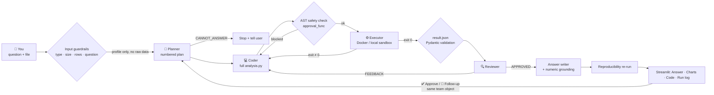

# 🧭 DataPilot — Self-Correcting Data Analyst

**Social Eagle · Track 3 (Agentic AI) · Use Case 03**

Upload a sales CSV/Excel file, ask a question in plain English, and a team of **AutoGen** agents plans the analysis,
writes pandas + matplotlib code, runs it in a sandbox, **fixes its own mistakes**, gets reviewed, and returns:

- a plain-English answer (every number traced back to executed code),
- labelled PNG charts,
- a re-runnable `analysis.py` (checked for reproducibility).


<sub>_Screenshot placeholder — add `docs/screenshot.png` after your first run._</sub>

---

## How it works



| Part | Choice |
|---|---|
| Agents | AutoGen AgentChat 0.7.5 — `AssistantAgent` × 3 (Planner, Coder, Reviewer) + `CodeExecutorAgent` |
| Team | `SelectorGroupChat` with a deterministic `selector_func` (default) or `RoundRobinGroupChat` (`TEAM_MODE`) |
| Termination | `TextMentionTermination("APPROVED") \| MaxMessageTermination(12)` (+ Planner `CANNOT_ANSWER`) |
| Executor | `DockerCommandLineCodeExecutor` → falls back to `LocalCommandLineCodeExecutor(work_dir="sandbox/")` with a yellow warning |
| Models | OpenAI `gpt-4.1` (Coder, Reviewer) · `gpt-4.1-mini` (Planner, Answer) · `temperature=0` — or Claude via `LLM_PROVIDER=anthropic` |
| UI / config | Streamlit · Pydantic v2 + pydantic-settings |

Human-in-the-loop follows AutoGen's web pattern: the team stops on `APPROVED`, you **Approve** or **Ask a follow-up**,
and the follow-up calls `run_stream()` on the **same team object**, so the agents keep the context.

### Files

| File | Purpose |
|---|---|
| `app.py` | Streamlit UI only |
| `team.py` | model clients, agents, executor wrapper, team, `selector_func`, answer writer, reproducibility check, terminal smoke test |
| `prompts.py` | one system message per agent |
| `schemas.py` | `DatasetProfile`, `ChartSpec`, `AnalysisResult`, `FinalAnswer` |
| `guardrails.py` | input, code-safety and output checks (no LLM) |
| `config.py` | `Settings` (pydantic-settings, `.env`) |
| `tests/test_guardrails.py` | pytest suite (51 tests) |
| `sample_data/sales_2026.csv` | 12,480 synthetic orders, Jan–Dec 2026 |
| `Dockerfile`, `.dockerignore` | code-sandbox image `datapilot-sandbox` (build context excludes `.env`) |
| `deploy/app.Dockerfile`, `deploy/docker-compose.yml` | app container behind Traefik with HTTPS + basic auth |

---

## 10-minute setup

**Requirements:** Python 3.12, an OpenAI API key with credits. Docker Desktop is optional (recommended).

```bash
git clone https://github.com/sundaji1969/Datapilot_self-correct_data-analyst.git
cd Datapilot_self-correct_data-analyst

python -m venv .venv
.venv\Scripts\activate          # Windows   (macOS/Linux: source .venv/bin/activate)
pip install -r requirements.txt

copy .env.example .env          # macOS/Linux: cp .env.example .env
# edit .env → OPENAI_API_KEY=sk-...
```

**Docker sandbox (recommended).** Start Docker Desktop and build the sandbox image once:

```bash
docker build -t datapilot-sandbox .
```

The image (`Dockerfile`) is `python:3.12-slim` + the pinned data libraries, running as a non-root `sandbox` user.
When Docker is running and the image exists, the app uses it automatically (🟢 Docker in the sidebar). Without it,
the app runs code in the local `sandbox/` folder and shows a 🟡 warning.

**Slow or unstable network inside Docker** (build fails with `Read timed out` from `files.pythonhosted.org`)?
Download the Linux packages on the host first, then build — pip installs them offline from `./wheels`:

```bash
pip download --only-binary=:all: --platform manylinux2014_x86_64 --platform manylinux_2_28_x86_64 \
  --python-version 3.12 --implementation cp -d wheels \
  pandas==3.1.1 numpy==2.5.5 matplotlib==3.11.2 openpyxl==3.1.5
docker build -t datapilot-sandbox .
```

**Run**

```bash
streamlit run app.py                         # add --server.port 8503 if 8501 is taken
python team.py "Why did Electronics revenue drop in September 2026 compared to August?"   # terminal smoke test
python -m pytest -q                          # guardrail tests
```

### Deploy to a VPS (Traefik + HTTPS + password)

`deploy/` runs the app as a container behind an **existing Traefik** reverse proxy (Docker provider, external network
`n8n_default`, cert resolver `mytlschallenge` — adjust these names in `deploy/docker-compose.yml` for your server).
Analysis code still runs in separate `datapilot-sandbox` containers, started through the Docker socket; they never see
the API key.

```bash
# on the server (Ubuntu + Docker); the repo MUST live at /opt/datapilot (sandbox bind-mount paths)
git clone https://github.com/sundaji1969/Datapilot_self-correct_data-analyst.git /opt/datapilot
cd /opt/datapilot
mkdir -p sandbox && chown -R 1000:1000 sandbox
cp .env.example .env && nano .env && chown 1000:1000 .env && chmod 600 .env     # OPENAI_API_KEY=...
docker build -t datapilot-sandbox .

# deploy/.env — never committed; single quotes stop Compose expanding the $ in the hash
cat > deploy/.env <<EOF
DATAPILOT_HOST=datapilot.example.com
DATAPILOT_AUTH='datapilot:$(openssl passwd -apr1)'
DOCKER_GID=$(getent group docker | cut -d: -f3)
EOF
chmod 600 deploy/.env

docker compose -f deploy/docker-compose.yml --env-file deploy/.env up -d --build
```

Then add a DNS **A record** for `DATAPILOT_HOST` pointing at the server; Traefik issues the HTTPS certificate on the
first visit. Visitors must log in (Traefik basic auth). The app container runs as uid 1000 with a 1 GB memory limit and
no published port. **Update:** `git pull` and re-run the `docker compose … up -d --build` line.

### Settings (`.env`)

| Key | Default | Meaning |
|---|---|---|
| `LLM_PROVIDER` | `openai` | `openai` or `anthropic` |
| `OPENAI_API_KEY` / `ANTHROPIC_API_KEY` | — | loaded as `SecretStr`, never logged or shown |
| `CODER_MODEL`, `REVIEWER_MODEL`, `PLANNER_MODEL`, `ANSWER_MODEL` | per provider | model overrides |
| `MAX_MESSAGES` | `12` | hard stop for one run |
| `EXEC_TIMEOUT_S` | `60` | per-script timeout |
| `MAX_FILE_MB` / `MAX_ROWS` | `25` / `500000` | upload limits |
| `TEAM_MODE` | `selector` | `selector` or `roundrobin` |
| `USE_DOCKER` | `true` | try Docker first |

---

## Sample input → output

**Input:** `sample_data/sales_2026.csv` — columns `order_date, region, category, product, units, unit_price, discount`

**Question:** _Why did Electronics revenue drop in September 2026 compared to August?_

**Agent run (real transcript, abridged):**

```
🧭 Planner   1. Filter Electronics … 2. revenue = units * unit_price * (1 - discount) …
             4. Group Aug and Sep revenue by region AND product … 6. Bar charts of the biggest drivers
💻 Coder     # filename: analysis.py  (full script)
⚙️ Executor  Electronics revenue dropped from ₹3,603,448.00 to ₹2,613,236.32 (-27.48%) …
             VALIDATION: PASSED
🔍 Reviewer  … both region and product drivers are identified, charts labelled with units.
             APPROVED                                   → 5/12 messages, ~7k tokens
```

**Answer:**

> Electronics revenue dropped by **₹9.90 lakh (27.48%)** in September 2026 compared to August 2026. The largest decline
> was in the **South** region (₹9.30 lakh). The biggest product contributor was **Smartwatch Lite** (₹5.23 lakh, of which
> ₹5.20 lakh in South), followed by **Earbuds X2** in South (₹3.81 lakh).

**Outputs:** `outputs/*.png` (axes in ₹ L), `outputs/result.json`, `analysis.py` — ✔ Reproducible.

**Self-correction example** (real run): the Coder put a region name into a numeric metric → `VALIDATION: FAILED`
(`metrics.max_discount_share_region: Input should be a valid number`) → Reviewer `FEEDBACK` →
Coder `Fixed: …` with a full rewrite → `VALIDATION: PASSED` → `APPROVED` (8/12 messages).

---

## Guardrails

**Input**
- Only `.csv` / `.xlsx`, ≤ 25 MB, ≤ 500,000 rows, no empty files; sheet picker for multi-sheet Excel.
- Column names normalised to `snake_case`; the mapping is shown to the user.
- Questions must be 5–500 characters; off-topic / unsafe requests (poems, deleting files, API keys, "ignore previous
  instructions") are refused; the Planner answers `CANNOT_ANSWER` when the columns can't answer the question.
- Only a pandas-built **profile** (types, nulls, 3 sample values, date range) is sent to the LLM — never the raw table.
- Cell values and column names are treated as **data, never instructions** (stated in the Planner and Coder prompts).

**Code execution**
- Static **AST check before every run** (via `CodeExecutorAgent.approval_func`): import allow-list
  (`pandas, numpy, matplotlib, json, pathlib, datetime, math, statistics, openpyxl`); blocks `eval`, `exec`,
  `__import__`, `os.system`, `subprocess`, `socket`, `requests`, `urllib`, `shutil.rmtree`, dunder access, absolute
  paths, `..`, and any file write outside `outputs/`. A blocked script never runs; the reason goes back to the Coder.
- Runs in Docker or in `sandbox/` only, with a 60 s timeout; the upload is copied to `sandbox/data/` (original untouched);
  `outputs/` is cleared before every run; API keys are removed from the sandbox environment.
- Cost limits: `MaxMessageTermination(12)`; tokens per run shown in the Run log.

**Output**
- `result.json` must validate against `AnalysisResult` (finite numbers, ≥ 1 chart, chart paths inside `outputs/`,
  every chart has a title and a unit on an axis). Validation errors are fed back as Reviewer feedback.
- **Numeric grounding:** every number in the written answer must exist in `result.json` (rounding, %, lakh/crore
  allowed). One regeneration; if it still fails, only the validated findings table is shown.
- **Reproducibility:** after approval, `analysis.py` is re-run in a fresh executor and the numbers compared —
  ✔ Reproducible or a red warning.
- The Reviewer can never approve after a failed run or failed validation; `APPROVED` only counts when it is the
  Reviewer's last line **and** the last run validated.

---

## Known limitations

- If Docker isn't running or the image isn't built, the app uses the local sandbox (AST-checked, time-limited, but
  not OS-isolated).
- With Docker, the sandbox container has a fixed name (`datapilot-exec`) so abandoned browser sessions can't pile up
  containers; the trade-off is one active analysis session at a time (a new session replaces the container).
- AutoGen's Docker executor has no option to disable container networking; network access from analysis code is
  blocked by the AST import allow-list instead (no `socket`, `requests`, `urllib`).
- With no `scipy` allowed, statistical tests are implemented by hand (e.g. a normal approximation for a t-test p-value).
